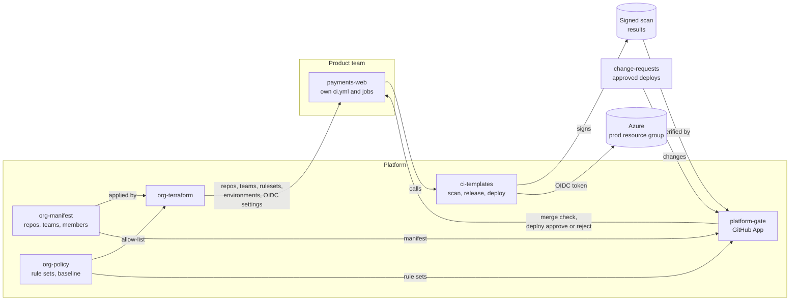
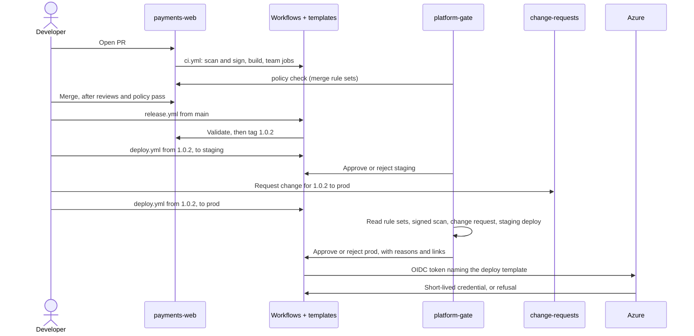

# Toolchain lab

A working model of a central CI/CD platform on GitHub Actions.

Product teams own their repos and pipelines. The platform team owns the guardrails: what must run, who must approve, and when code may deploy. Teams add their own jobs freely but cannot remove or bypass the guardrails from their own repos.

## Highlights

- **Guardrails live outside team repos.** A GitHub App, the gate, is a required merge check and the protection rule on every deploy environment. Teams have write access, not admin, so they cannot change either.
- **Rules are data.** Rule sets in `org-policy` pick and configure rule types coded in the gate. Each repo picks its sets per environment in `org-manifest`. Every verdict lists what was met and not met, with links to the rule's definition.
- **Releases move through test, staging and prod.** Merging only runs CI. Releases are immutable `X.Y.Z` tags. Prod takes only a release that went to staging first, inside deploy hours, covered by a change request approved by the owning team, never by the requester or deployer.
- **Mandatory scans prove where they ran.** The central scan template signs its result. The gate accepts only results signed by that template, not by a team's workflow.
- **Prod deploys to Azure with no stored secret.** The deploy job logs in with GitHub's OIDC token. Azure trusts the token only if it names the repo, the environment and the central deploy template. [Shown](#deploy-credentials): a rogue job that got through review, release, staging and change approval was refused by Azure, while the template's job deployed.
- **The org is code.** Repos, teams, rulesets, environments and the Actions policy come from reviewed files. Terraform plans every hour and on every change, and a person approves each apply. A change made by hand shows up in the next plan, and the next approved apply reverts it.
- **Templates are versioned per template.** Fixes reach every repo through a moving major tag. Breaking changes ship as the next major, which teams adopt with a PR.

## Found along the way

What broke or surprised, and what changed because of it:

| Finding | Result |
|---|---|
| The gate checked that a deploy **run** used the central template, not which **job** asked for `prod`. A job a team adds with `environment: prod` gets the environment's secrets | Deploy credentials moved out of GitHub, to OIDC bound to the template. Gate-side check in the backlog |
| Repos created after 2026-07-15 get immutable IDs in their OIDC subject: `repo:Stefan-org-1@350111267/payments-web@1439253121` | Trust rules copied from the deploy log, not written from memory |
| A major template version is part of the cloud trust rule | `deploy-v2`, not a change to v1. Wildcard matching exists in Azure but is in preview, so not used |
| `terraform plan` does not check permissions. The apply failed partway on a permission the App lacked | Granted the permission and applied the rest. Terraform has no rollback; state recorded what succeeded. Open: nothing found it before the apply |
| A reviewer team without access to the repo is silently dropped from an environment, leaving nobody able to approve the apply | Fixed with a break-glass apply from a laptop, recorded on the PR |
| A merge that bypasses the `policy` check can never be released or deployed to prod | By design. Bypasses are for platform repos, not product code |
| Scheduled workflows are best effort. The gate's 10-minute schedule once skipped 7 hours | Run by hand in the lab. A webhook relay is in the backlog |

## Repos

| Repo | What it holds | Owner |
|---|---|---|
| [org-manifest](https://github.com/Stefan-org-1/org-manifest) | Approved repos, teams and members, and the rule sets each repo picks | Teams edit their own file. Their sentinels or managers approve |
| [org-policy](https://github.com/Stefan-org-1/org-policy) | Rule sets, baseline, emergency approvals, Actions allow-list | Platform |
| [org-terraform](https://github.com/Stefan-org-1/org-terraform) | Terraform that applies the manifest and policy to GitHub, and the OIDC settings | Platform |
| [ci-templates](https://github.com/Stefan-org-1/ci-templates) | Reusable build, scan, release and deploy workflows, versioned per template | Platform |
| [platform-gate](https://github.com/Stefan-org-1/platform-gate) | The gate: a GitHub App that checks PRs and approves or rejects deploys | Platform |
| [change-requests](https://github.com/Stefan-org-1/change-requests) | Approved deploys: version, environments, window, approvers. Stands in for Jira or ServiceNow | Platform, teams add changes |
| [payments-web](https://github.com/Stefan-org-1/payments-web) | Example product repo | team-payments |

## How the pieces fit



- **org-manifest and org-policy are the source of truth.** org-terraform applies them to GitHub. The gate reads them on every check.
- **The gate's mark cannot be forged.** Rulesets require the `policy` check from the App's ID, and the App is the protection rule on each environment. Only the holder of its private key can act as it.
- **Results from team pipelines count only if signed** by the central template.
- **Azure trusts the template, not the repo.** The trust rule names the central deploy template, so no other job can log in, wherever it runs.

## Gates and rule sets

The gate checks every PR before merge and every deploy before it gets its environment. What it checks comes from **rule sets**: small named groups of rules, kept as YAML in `org-policy`. Each repo picks its sets in `org-manifest`.

- Every repo gets the baseline sets. Its manifest entry adds more, per environment.
- **Hard** sets must pass. **Soft** sets, such as deploy hours, can be overridden by an emergency change approved by a sentinel and a manager.
- Changing what a repo needs is a one-line manifest change. A new kind of check is a new rule type in `platform-gate`.

<details>
<summary>Example: what payments-web needs in each environment</summary>

```yaml
# org-policy/baseline.yaml: every repo
deploy:
  all: [platform-integrity, central-deploy, green-pipeline]
  prod: [deploy-window]

# org-manifest/repos/payments.yaml: this repo
deploy:
  test: [from-main, scanned]
  staging: [released, scanned]
  prod: [released, staged, change-team, scanned]
```

A prod deploy needs all eight sets to pass: the repo is active, the deploy uses the central template, CI is green, it is inside deploy hours, the commit is a release on `main` or a `release/X.Y.z` branch, that release went to staging first, a change request approved by the team covers it, and the template's signed scan passed.

Each key under `deploy` is an environment, so an app gets the environments it lists.
</details>

All rule sets and what they check: [org-policy: Rule sets](https://github.com/Stefan-org-1/org-policy#rule-sets).

## Teams change their pipelines safely

Teams own their `ci.yml`. They add jobs, configure templates through inputs, and add build steps through hooks, without asking platform. None of that can skip a guardrail, because the guardrails are not in the team's workflow:

- **Gates live outside the repo's workflows.** The merge check is required by a repo ruleset and the deploy waits on an environment rule. Teams cannot change either.
- **Mandatory checks prove where they ran.** The scan signs its result as the central template. A team job that fakes it signs as the team's workflow and is rejected.
- **Team code runs apart from mandatory checks.** Hooks run in the build job. The scan runs in its own job, on a fresh runner, from a fresh checkout.
- **Deploy credentials trust only the template.** A team job that names `prod` is refused by Azure.
- **Workflow changes need a sentinel's review**, and third-party actions must be on the allow-list and pinned to a commit SHA.

What teams can change, and what each bypass attempt runs into: [ci-templates: Customizing your pipeline](https://github.com/Stefan-org-1/ci-templates#customizing-your-pipeline).

## From merge to prod

Merging, releasing and deploying are separate steps. A merge only runs CI. People start releases and deploys by hand.

| Environment | Takes | Needs |
|---|---|---|
| `test` | `main`, a snapshot | Commit on `main`, signed scan |
| `staging` | A release `X.Y.Z` | Release, signed scan |
| `prod` | The same release | Release, deployed to staging first, change request, deploy hours |



- **Releases follow [Continuous Delivery Flow](https://continuousdeliveryflow.com/).** `main` and `release/X.Y.z` branches hold snapshots. A release is an immutable tag `X.Y.Z`. Snapshots go only to `test`. Staging and prod take releases.
- **`release.yml` checks before tagging,** because tags cannot be moved or deleted: the branch, that the commit passed the merge gate, and that the version is new. The gate checks the release again at deploy.
- **The change request can come before or after the deploy starts.** It covers a version, environments and a time window.
- **Hotfixes** go on a `release/X.Y.z` branch cut from the tag in prod, and can skip staging and deploy hours with an emergency change.

## Deploy credentials

No deploy credential is stored in GitHub. The central `deploy.yml` asks GitHub for an OIDC token, and Azure swaps it for a short-lived credential if the token matches the trust rule:

```
repo:Stefan-org-1@350111267/payments-web@1439253121:environment:prod:job_workflow_ref:Stefan-org-1/ci-templates/.github/workflows/deploy.yml@refs/tags/deploy-v2
```

GitHub fills in every part from the run. `environment:prod` appears only after the gate approves, and `job_workflow_ref` names the file that defines the job, which a team cannot change.

| Piece | Where |
|---|---|
| Identity `id-payments-web-prod`, one per app and environment | Azure, resource group `rg-platform-identities`, which teams cannot change |
| Role: Tag Contributor on `rg-payments-web-prod` only. The mock deploy tags the group with the version | Azure |
| Trust rule, matched exactly | Azure, on the identity |
| Subject format with `job_workflow_ref`, set per repo | `org-terraform` |
| Tenant, subscription, client ID and resource group, as variables on the environment. They identify, they grant nothing | `org-terraform` |

The rogue job demo: [payments-web#9](https://github.com/Stefan-org-1/payments-web/pull/9) adds a job `sneaky` with `environment: prod` to the team's `deploy.yml`, and is kept on `main` as the example. A sentinel approved it, playing one who missed it. Release `1.0.2` to prod ([run](https://github.com/Stefan-org-1/payments-web/actions/runs/41681768160)): the gate approved the run, so both jobs started.

| Job | Token's `job_workflow_ref` | Result |
|---|---|---|
| [`deploy`](https://github.com/Stefan-org-1/payments-web/actions/runs/41681768160/job/126076998574) | `ci-templates/.github/workflows/deploy.yml@refs/tags/deploy-v2` | Logged in, tagged `version=1.0.2` |
| [`sneaky`](https://github.com/Stefan-org-1/payments-web/actions/runs/41681768160/job/126076998073), added by the team | `payments-web/.github/workflows/deploy.yml@refs/tags/1.0.2` | Refused: `AADSTS700213` |

Run from a branch instead of a release, the same job never started: [the gate rejected it](https://github.com/Stefan-org-1/payments-web/actions/runs/41680115796) on four rule sets.

## The org as code

`org-terraform` applies `org-manifest` and `org-policy` to GitHub.

- **Reviewed input.** A team edits its own manifest file, and its sentinels or managers approve, enforced by code-owner review. A validator rejects files that define another team, widen access, or name rule sets that do not exist.
- **Plan automatically, apply by decision.** The `reconcile` workflow plans hourly and on every change, and summarizes it: destroys first, then links to what merged since the last apply. A member of `group-org-approvers` approves the apply, which applies exactly the reviewed plan.
- **One run at a time.** A concurrency group, and HCP Terraform's state lock.
- **Guard rails on Terraform itself.** It refuses to plan when the manifest loads empty, and teams, groups and the Actions policy cannot be destroyed by a plan.

Details: [org-terraform](https://github.com/Stefan-org-1/org-terraform#how-changes-are-applied).

## What is enforced, and where

| Guarantee | How | Where |
|---|---|---|
| Org changes are reviewed by the right people | Code-owner review: a team's sentinels or managers for its manifest file, platform for the rest. A validator rejects tampering | `org-manifest` `CODEOWNERS` and `validate.py` |
| Org changes are applied by a person's decision | The apply job waits for `group-org-approvers` | `org-terraform` `reconcile` |
| Only approved repos exist and deploy | Repos are created from the manifest. Deploys of repos not active in it are rejected | `org-manifest`, rule set `platform-integrity` |
| Mandatory scans on every change: secrets, SonarQube | `scan.yml` runs them in its own job and signs the result. The gate requires it from `scan.yml` | `ci-templates` `scan.yml`, rule set `scanned` |
| Workflow changes reviewed by a sentinel | The gate requires a sentinel's approval when `.github/workflows/` changes | Rule set `workflow-sentinel` |
| Prod deploys only through the central template | The gate checks the run used `deploy.yml`. Azure trusts only that template's job | Rule set `central-deploy`, Azure trust rule |
| No stored deploy credentials | OIDC token swapped for a short-lived Azure credential | `ci-templates` `deploy.yml`, `org-terraform` |
| Prod deploys approved by the owning team, not the requester or deployer | Change request approvers checked against the owning team | `change-requests`, rule set `change-team` |
| Prod gets only releases, tested in staging first | Release tags are immutable. The gate requires a release on `main` or `release/X.Y.z`, deployed to staging | Rule sets `released`, `staged`, tag ruleset `release-tags` |
| Green CI, inside deploy hours | Soft rule sets, overridable by an emergency change | Rule sets `green-pipeline`, `deploy-window` |
| Emergency changes approved outside the deployer, time-limited | At most 24 hours, needs a sentinel and a manager of the owning team | `org-policy/baseline.yaml` |
| Third-party actions allow-listed and pinned to a SHA | Org Actions policy | `org-policy/actions-allowlist.yaml`, `org-terraform` |
| Template fixes reach every repo, breaking changes are opt-in | Each template has its own moving major tag, such as `deploy-v2` | `ci-templates` |

## Known gaps

- The gate approves every job in a run that names the environment. It should reject jobs not defined by the deploy template.
- Azure identities and trust rules were created in the portal. They belong in Terraform, generated from the manifest, with one rule per template major.
- Only payments-web prod uses OIDC. Test and staging have no Azure identity.
- Anyone who can tag `ci-templates` can create a trusted template version. A tag ruleset should limit that to platform.
- The gate runs on a schedule, not on events.
- The gate's protection rule is attached to environments by hand, so Terraform does not restore it.
- Change requests are trusted as written. A real change system records who approved.
- A plan cannot show whether the apply will be allowed, so a missing permission first shows up as a partial apply on the real org. No clear answer yet: a test org only helps if it matches the real one exactly.

## Teams

- `team-<area>`: product teams, owners of their code.
- `group-sentinels`, `group-managers`: senior engineers and managers across teams.
- `sentinels-<area>`, `managers-<area>`: the owning team's own sentinels and managers, nested under the groups.
- `group-org-approvers`: who approves org changes.

Membership is declared in `org-manifest` and applied by `org-terraform`.

## More

- [Requirements](https://github.com/Stefan-org-1/.github/blob/main/docs/requirements.md)
- [Design notes](https://github.com/Stefan-org-1/.github/blob/main/docs/design.md): gate design, threats, how signed results were tested
