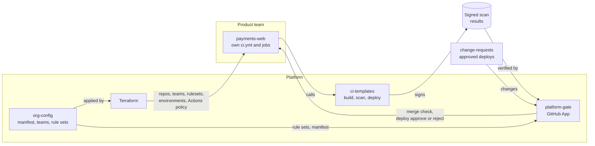
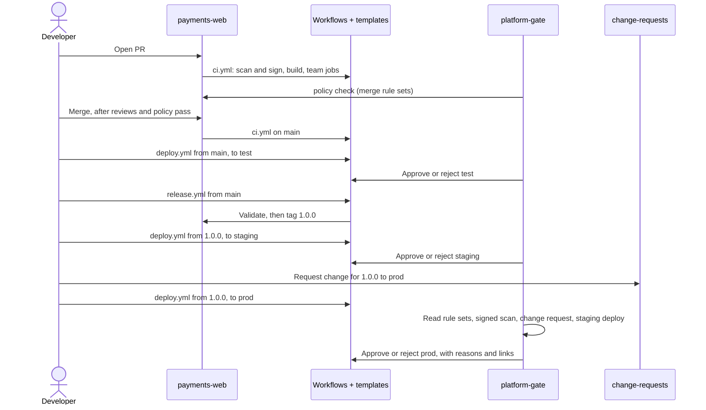

# Toolchain lab

A working model of a central CI/CD platform on GitHub Actions.

Product teams own their repos and pipelines. The platform team owns the guardrails: what must run, who must approve, and when code may deploy. Teams add their own jobs freely but cannot remove or bypass the guardrails from their own repos.

## Repos

| Repo | What it holds | Owner |
|---|---|---|
| [org-config](https://github.com/Stefan-org-1/org-config) | Manifest of approved repos, teams and members, rule sets, Terraform that applies them | Platform, teams edit their own file |
| [ci-templates](https://github.com/Stefan-org-1/ci-templates) | Reusable build, scan and deploy workflows, versioned by major tag | Platform |
| [platform-gate](https://github.com/Stefan-org-1/platform-gate) | The gate: a GitHub App that checks PRs and approves or rejects deploys | Platform |
| [change-requests](https://github.com/Stefan-org-1/change-requests) | Approved deploys: version, environments, window, approvers. Stands in for Jira or ServiceNow | Platform, teams add changes |
| [payments-web](https://github.com/Stefan-org-1/payments-web) | Example product repo | team-payments |

## How the pieces fit



- **org-config is the source of truth.** Terraform applies it to GitHub. The gate reads it on every check.
- **The gate's mark cannot be forged.** Rulesets require the `policy` check from the App's ID, and the App is the protection rule on `prod`. Only the holder of its private key can act as it.
- **Rules are data, rule types are code.** Rule sets in `org-config` pick and configure rule types written in `platform-gate`.
- **Results from team pipelines count only if signed.** The template's scan runs in its own job and signs its result. The gate checks the signer is the central template, not the team's workflow.

## Gates and rule sets

The gate checks every PR before merge and every deploy before it gets its environment. What it checks comes from **rule sets**: small named groups of rules, kept as YAML in `org-config`.

- Every repo gets the baseline sets. Its manifest entry adds more, per environment.
- **Hard** sets must pass. **Soft** sets, such as deploy hours, can be overridden by an emergency change with break-glass approvals.
- Changing what a repo needs is a one-line manifest change. A new kind of check is a new rule type in `platform-gate`.

<details>
<summary>Example: what payments-web needs in each environment</summary>

```yaml
# org-config/baseline.yaml: every repo
deploy:
  all: [platform-integrity, central-deploy, green-pipeline]
  prod: [deploy-window]

# org-config/repos/payments.yaml: this repo
deploy:
  test: [from-main, scanned]
  staging: [released, scanned]
  prod: [released, staged, change-team, scanned]
```

A prod deploy needs all eight sets to pass: the repo is active, the deploy uses the central template, CI is green, it is inside deploy hours, the commit is a release on `main` or a `release/X.Y.z` branch, that release went to staging first, a change request approved by the team covers it, and the template's signed scan passed.

Each key under `deploy` is an environment, so an app gets the environments it lists.
</details>

All rule sets and what they check: [org-config: Rule sets](https://github.com/Stefan-org-1/org-config#rule-sets).

## Teams change their pipelines safely

Teams own their `ci.yml`. They add jobs, configure templates through inputs, and add build steps through hooks, without asking platform. None of that can skip a guardrail, because the guardrails are not in the team's workflow:

- **Gates live outside the repo's workflows.** The merge check is required by a repo ruleset and the deploy waits on an environment rule. Teams have write access, not admin, so they cannot change either.
- **Mandatory checks prove where they ran.** The scan signs its result as the central template. A team job that fakes it signs as the team's workflow and is rejected.
- **Team code runs apart from mandatory checks.** Hooks run in the build job. The scan runs in its own job, on a fresh runner, from a fresh checkout.
- **Workflow changes need a sentinel's review**, and third-party actions must be on the allow-list and pinned to a commit SHA.

What teams can change, and what each bypass attempt runs into: [ci-templates: Customizing your pipeline](https://github.com/Stefan-org-1/ci-templates#customizing-your-pipeline).

## From merge to prod

Merging, releasing and deploying are separate steps. A merge only runs CI. People start releases and deploys by hand.

| Environment | Takes | Needs |
|---|---|---|
| `test` | `main`, a snapshot | Commit on `main`, signed scan |
| `staging` | A release `X.Y.Z` | Release, signed scan |
| `prod` | The same release | Release, deployed to staging first, change request, deploy hours |



- **Releases follow [Continuous Delivery Flow](https://continuousdeliveryflow.com/).** `main` and `release/X.Y.z` branches hold snapshots. A release is an immutable tag `X.Y.Z`. Snapshots go only to `test`; staging and prod take releases. A failed release number is never reused.
- **`release.yml` checks before tagging,** because tags cannot be moved or deleted: the branch, that the commit passed the merge gate, and that the version is new and on the right line. The gate checks the release again at deploy.
- **The change request can come before or after the deploy starts.** It covers a version, environments and a time window, and can be used for any number of deploys inside it.
- **Hotfixes** go on a `release/X.Y.z` branch cut from the tag in prod, and can skip staging and deploy hours with an emergency change.

## What is enforced, and where

| Guarantee | How | Where |
|---|---|---|
| Only approved repos exist and deploy | Repos are created from the manifest. Deploys of repos not active in it are rejected | `org-config/repos/`, rule set `platform-integrity` |
| Mandatory scans on every change: secrets, SonarQube | `scan.yml` runs them in its own job and signs the result. Gate requires it from `scan.yml` | `ci-templates` `scan.yml`, rule set `scanned` |
| Workflow changes reviewed by a sentinel | Gate requires a sentinel's PR approval when `.github/workflows/` changes | Rule set `workflow-sentinel` |
| Prod deploys only through the central template | Gate checks the deploy used `deploy.yml` | Rule set `central-deploy` |
| Prod deploys approved by the owning team, not the requester or deployer | Change request approvers checked against the owning team | `change-requests`, rule sets `change-team`, `change-two-person` |
| Prod gets only releases, tested in staging first | Release tags are immutable. The gate requires a release on `main` or `release/X.Y.z`, deployed to staging | Rule sets `released`, `staged`, tag ruleset `release-tags` |
| Green CI, inside deploy hours | Soft rule sets, overridable by an emergency change | Rule sets `green-pipeline`, `deploy-window` |
| Break-glass is approved outside the deployer and time-limited | Emergency change, at most 24 hours, needs a sentinel and a manager of the owning team | `org-config/baseline.yaml` |
| Third-party actions allow-listed and pinned to a SHA | Org Actions policy | `org-config/actions-allowlist.yaml`, Terraform |
| Template fixes reach every repo, breaking changes are opt-in | Each template has its own moving major tag, such as `scan-v1` | `ci-templates` |

Every gate result lists what was not met and how the rest was met: which change approved, which release and staging deploy, who signed the scan. Each line links to its rule set's definition.

## Teams

- `team-<area>`: product teams, owners of their code.
- `group-sentinels`, `group-managers`: senior engineers and managers across teams.
- `sentinels-<area>`, `managers-<area>`: the owning team's own sentinels and managers, nested under the groups.

Membership is declared in `org-config` and applied by Terraform.

## More

- [Requirements](https://github.com/Stefan-org-1/.github/blob/main/docs/requirements.md)
- [Design notes](https://github.com/Stefan-org-1/.github/blob/main/docs/design.md): gate design, threats, how signed results were tested
