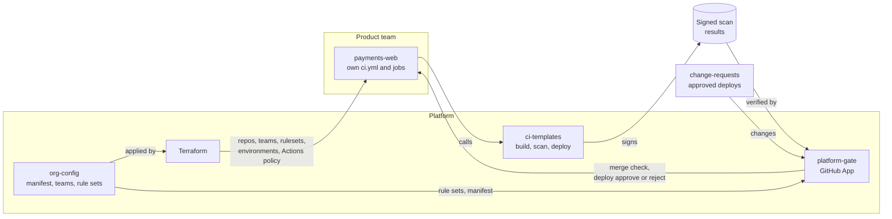
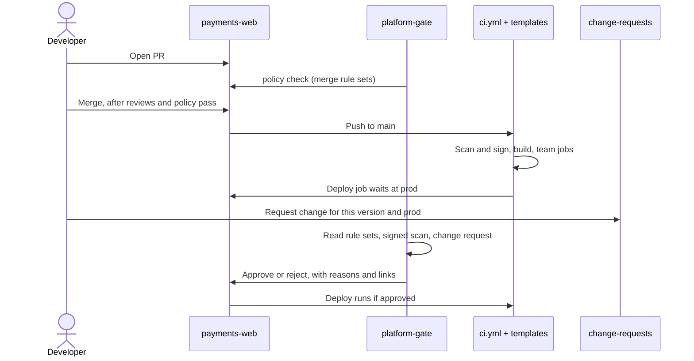

# Toolchain lab

A working model of a central CI/CD platform on GitHub Actions.

Product teams own their repos and pipelines. The platform team owns the guardrails: what must run, who must approve, and when code may deploy. Teams add their own jobs freely but cannot remove or bypass the guardrails from their own repos.

## Repos

| Repo | What it holds | Owner |
|---|---|---|
| [org-config](https://github.com/Stefan-org-1/org-config) | Manifest of approved repos, teams and members, rule sets, Terraform that applies them | Platform, teams edit their own file |
| [ci-templates](https://github.com/Stefan-org-1/ci-templates) | Reusable build, scan and deploy workflows, versioned by major tag | Platform |
| [platform-gate](https://github.com/Stefan-org-1/platform-gate) | The gate: a GitHub App that checks PRs and approves or rejects deploys | Platform |
| [change-requests](https://github.com/Stefan-org-1/change-requests) | Approved deploys: version, environments, window, approvers. Stands in for Jira or ServiceNow | Platform, teams add changes |
| [payments-web](https://github.com/Stefan-org-1/payments-web) | Example product repo | team-payments |

## How the pieces fit

- **org-config is the source of truth.** Terraform applies it to GitHub. The gate reads it on every check.
- **The gate's mark cannot be forged.** Rulesets require the `policy` check from the App's ID, and the App is the protection rule on `prod`. Only the holder of its private key can act as it.
- **Rules are data, rule types are code.** Rule sets in `org-config` pick and configure rule types written in `platform-gate`.
- **Results from team pipelines count only if signed.** The template's scan runs in its own job and signs its result. The gate checks the signer is the central template, not the team's workflow.

## A release, end to end

Merge and deploy are separate. Here a push to `main` starts the deploy, but a team can start it by hand or by tag instead. The gate checks the same rules either way.

The change request can come before or after the deploy starts. It covers a version, environments and a time window, and can be used for any number of deploys inside it.

## What is enforced, and where

| Guarantee | How | Where |
|---|---|---|
| Only approved repos exist and deploy | Repos are created from the manifest. Deploys of repos not active in it are rejected | `org-config/repos/`, rule set `platform-integrity` |
| Mandatory scan on every change | Template scan job signs its result. Gate requires it from the template | `ci-templates` `node-build.yml`, rule set `scanned` |
| Workflow changes reviewed by a sentinel | Gate requires a sentinel's PR approval when `.github/workflows/` changes | Rule set `workflow-sentinel` |
| Prod deploys only through the central template | Gate checks the deploy used `deploy.yml` | Rule set `central-deploy` |
| Prod deploys approved by the owning team, not the requester or deployer | Change request approvers checked against the owning team | `change-requests`, rule sets `change-team`, `change-two-person` |
| Deploys only from `main`, green pipelines, inside deploy hours | Soft rule sets, overridable by an emergency change | Rule sets `from-main`, `green-pipeline`, `deploy-window` |
| Break-glass is approved outside the deployer and time-limited | Emergency change, at most 24 hours, needs a sentinel and a manager of the owning team | `org-config/baseline.yaml` |
| Third-party actions allow-listed and pinned to a SHA | Org Actions policy | `org-config/actions-allowlist.yaml`, Terraform |
| Template fixes reach every repo, breaking changes are opt-in | Moving major tags `v1`, `v2` | `ci-templates` |

Every gate result names the rule set that failed, links to its definition, and says why.

## Teams

- `team-<area>`: product teams, owners of their code.
- `group-sentinels`, `group-managers`: senior engineers and managers across teams.
- `sentinels-<area>`, `managers-<area>`: the owning team's own sentinels and managers, nested under the groups.

Membership is declared in `org-config` and applied by Terraform.

## More

- [Requirements](https://github.com/Stefan-org-1/.github/blob/main/docs/requirements.md)
- [Design notes](https://github.com/Stefan-org-1/.github/blob/main/docs/design.md): gate design, threats, how signed results were tested
